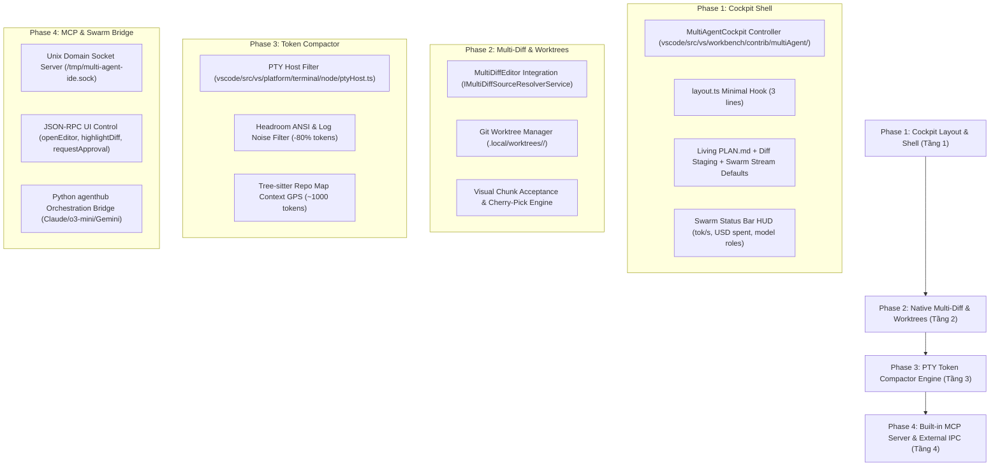

# Multi Agent IDE — Agent-First Transformation Master Plan

> **Strategic Objective:** Transform the codebase from a conventional *"VS Code with an extension attached"* into a native, deeply integrated **Agent-First Multi-Agent Development Environment** optimized for parallel swarms (Claude 3.7 Architect, OpenAI o3-mini Worker, Gemini 2.5 Pro Auditor).

---

## 1. Paradigm Shift: "VS Code + Extension" vs. "Native Agent-First IDE"

```
TRADITIONAL VS CODE + EXTENSION (Cursor / Cline / Copilot):
+-----------------------------------------------------------------------------------------+
| [Primary Sidebar]  | [Single Monaco Editor]                           | [Chat Webview]  |
| - File Explorer    | - Developer manually writes code                 | - Single LLM    |
| - Standard Git     | - Main branch directly polluted                  |   monologue     |
|                    | - No visual DAG, no parallel worktrees           | - No verification|
+-----------------------------------------------------------------------------------------+

NATIVE AGENT-FIRST MULTI-AGENT IDE:
+-----------------------------------------------------------------------------------------+
| [Cột 1: Living Plan]       | [Cột 2: Multi-Diff Staging]     | [Cột 3: Swarm Activity Stream] |
| - PlanManifest DAG         | - Continuous MultiDiffEditor    | - Architect / Worker / Auditor  |
| - Frontmatter State Check  | - Cross-Worktree Patch Review   | - Realtime Token/s & Cost HUD   |
| - Dynamic Task Checklist   | - Side-by-Side Chunk Merge      | - 3-Tier Human Risk Gates       |
+-----------------------------------------------------------------------------------------+
| Status Bar HUD: [Swarm: Executing] | [Tokens: 52 tok/s] | [Cost: $0.18 USD] | [Autopilot: ON]  |
| Kernel Engine: PTY Compaction (-80% tokens) | Unix Domain Socket MCP (/tmp/multi-agent-ide.sock)|
+-----------------------------------------------------------------------------------------+
```

---

## 2. Four-Phase Architectural Transformation



---

## 3. Phase-by-Phase Technical Specifications

### Phase 1: Native Cockpit Layout & Shell Transformation (Tầng 1)
- **Problem:** Stock VS Code defaults to a single blank editor and the explorer tree. The developer must manually configure windows and open webviews.
- **Agent-First Solution:**
  1. Create `vscode/src/vs/workbench/contrib/multiAgent/browser/multiAgentCockpit.ts` implementing `MultiAgentCockpit`:
     - Checks `workbench.agentCockpit.enabled`.
     - Returns default 3-column `EditorGroupLayout` (`size: 0.28, 0.44, 0.28`).
     - Resolves the 3 cockpit files: `PLAN.md` (Col 1), `.local/DIFF_STAGING.diff` (Col 2), `.local/SWARM_ACTIVITY.md` (Col 3).
  2. Embed a 3-line hook in `vscode/src/vs/workbench/browser/layout.ts` delegating to `MultiAgentCockpit`.
  3. Register the Swarm Status Bar HUD showing live telemetry.
  4. Auto-collapse primary explorer on boot to maximize cockpit screen real estate.

### Phase 2: First-Class Multi-Worktree & Continuous Multi-Diff Kernel (Tầng 2)
- **Problem:** Extensions display diffs in temporary webviews or standard 2-file diff editors, forcing developers to review one file at a time while polluting the working git tree.
- **Agent-First Solution:**
  1. Implement `AgentMultiDiffSourceResolver` registering with `IMultiDiffSourceResolverService` (`vscode/src/vs/workbench/contrib/multiDiffEditor`).
  2. Map `agent-diff://staged` directly to native `MultiDiffEditorInput`.
  3. All agent modifications occur inside `.local/worktrees/<task-id>/` on branch `agent/<task-id>`.
  4. The multi-diff canvas displays all modified files simultaneously in a single scrollable view with inline chunk acceptance buttons.

### Phase 3: PTY Token Compactor Engine & Context Hygiene (Tầng 3)
- **Problem:** When an agent runs build tools (`npm test`, `cargo build`, `pytest`), terminal outputs often emit 5,000–20,000 tokens of ANSI codes, progress bars, and redundant logs, exhausting model context windows.
- **Agent-First Solution:**
  1. Patch `vscode/src/vs/platform/terminal/node/ptyHost.ts` to attach a Headroom stream filter.
  2. Strip ANSI escape codes, strip passing test lines, and isolate exact stack traces and assertion errors.
  3. Reduce LLM token consumption by up to 80% before output is piped to agent context.
  4. Integrate Tree-sitter PageRank repo-map (`repomap.py`) to feed agents a ~1,000-token codebase map.

### Phase 4: Built-in MCP Server & External Swarm Controller (Tầng 4)
- **Problem:** External agent CLIs (Claude Code, Antigravity CLI, Codex CLI) running in the terminal cannot inspect or manipulate the IDE UI without fragile browser automations.
- **Agent-First Solution:**
  1. The IDE binary opens a Unix Domain Socket at `/tmp/multi-agent-ide.sock` on startup.
  2. Expose an MCP (Model Context Protocol) server providing tools:
     - `ide_open_diff(taskId, fileUri)`
     - `ide_highlight_range(fileUri, startLine, endLine)`
     - `ide_request_human_approval(action, riskScore)`
     - `ide_update_plan(planManifestJson)`
  3. Connect the Python `agenthub` engine directly to this socket for real-time bi-directional UI synchronization.

---

## 4. Upstream Upgrade & Maintenance Protocol (Zero-Friction Rebase)

To ensure this Agent-First IDE remains easily upgradeable to future Code-OSS versions:
1. **Zero Clutter in Upstream Files:** Upstream files only contain minimal hooks calling our `multiAgent` contrib modules.
2. **Patch Extraction:** All changes to `vscode/` are backed up as numbered patches in `patches/` (`patches/90-*.patch`).
3. **Single Source of Truth:** `src/stable/extensions/multi-agent-harness` is symlinked to `vscode/extensions/multi-agent-harness`.
4. **Graphify Synchronization:** `graphify update .` is executed after each milestone to keep the knowledge graph current.

