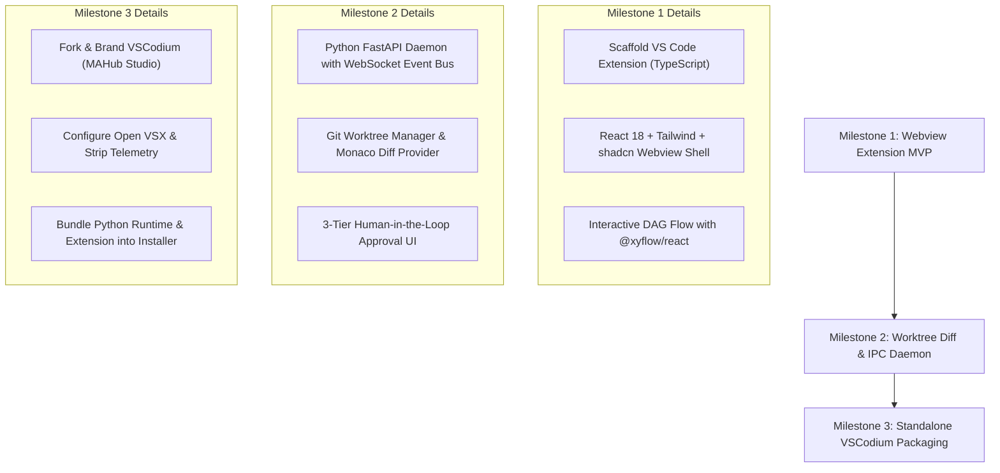

# Technical Blueprint 06: MAHub IDE UI Architecture & Implementation Plan

## 1. Vision & Core Philosophy

**MAHub IDE** is an open-source, multi-agent AI development environment designed to transform software engineering from single-agent prompting into an orchestrated team of specialized agents (Architect, Coder, Auditor) supervised by a human developer.

Familiarity is essential: developers should feel completely at home with VS Code's standard editor layouts, shortcuts, and keybindings, while gaining native superpowers for multi-agent coordination, git worktree isolation, and visual diff reviews.

---

## 2. Core Architectural Decisions (Grill-Me Grounding)

| Architectural Domain | Selected Strategy | Rationale & Tradeoffs |
| :--- | :--- | :--- |
| **Delivery Model** | **Hybrid Path**: Phase 1 Extension Suite $\rightarrow$ Phase 2 VSCodium Binary | Minimizes time-to-value; allows rapid iteration inside standard VS Code/VSCodium before compiling standalone distribution binaries. |
| **Agent Layout** | **Secondary Sidebar Swimlanes + Interactive DAG Graph** | Separates orchestrator supervision from standard file tree; gives simultaneous visibility into parallel agent states, tasks, and token metrics. |
| **Diff & Review** | **Native Monaco Diff Editor + Worktree Switcher** | Zero context switching; leverages VS Code's battle-tested 3-way side-by-side diffing across isolated `.local/worktrees/<task-id>`. |
| **Frontend Stack** | **React 18 + Tailwind CSS + shadcn/ui + @xyflow/react** | Production-ready component ecosystem; rich graph visualization; native synchronization with VS Code CSS custom properties (`var(--vscode-*)`). |
| **IPC & Sync** | **Local WebSocket Daemon & JSON-RPC (FastAPI)** | High-throughput token streaming with sub-5ms latency; decoupled architecture allows CLI and GUI to share identical orchestrator state. |
| **Safety & Gates** | **3-Tier Risk Hierarchy with Autopilot Toggle** | Eliminates confirmation fatigue for safe tasks while enforcing a hard human approval stop for shell mutations and main-branch merges. |

---

## 3. System Architecture & Topology

```
+-----------------------------------------------------------------------------------+
| MAHub IDE (VS Code / VSCodium Host Window)                                        |
|                                                                                   |
|  +--------------------+  +----------------------------+  +---------------------+  |
|  | Primary Sidebar    |  | Main Editor Area           |  | Secondary Sidebar   |  |
|  | - File Explorer    |  | - Active File / Editor     |  | - Orchestrator Hub  |  |
|  | - Git Source Ctrl  |  | - Monaco 3-Way Diff Editor |  | - Agent Swimlanes   |  |
|  | - Open VSX Exts    |  | - Interactive DAG Canvas   |  | - Task Checklist    |  |
|  +--------------------+  +----------------------------+  +---------------------+  |
|  +-----------------------------------------------------------------------------+  |
|  | Status Bar: Active Worktree Selector [wt: task-auth-102] | Autopilot: ON/OFF |  |
|  +-----------------------------------------------------------------------------+  |
|                                                                                   |
|  +-----------------------------------------------------------------------------+  |
|  | MAHub Webview Panels (React 18 + shadcn/ui + Tailwind + @xyflow/react)      |  |
+--+-----------------------------------------------------------------------------+--+
                                        |
                            JSON-RPC over WebSocket
                         ws://127.0.0.1:<port> (Token Auth)
                                        |
+---------------------------------------v-------------------------------------------+
| MAHub Python Core Daemon (FastAPI + Uvicorn + Asyncio Event Bus)                   |
|                                                                                   |
|  +-----------------------------------------------------------------------------+  |
|  | Orchestrator Controller: Strength-Based Routing & Dynamic Agent Dispatch     |  |
|  | - Architect Agent (Planning & DAG Generation)                               |  |
|  | - Coder Worker Agents (Parallel Code Generation)                            |  |
|  | - Auditor / QA Agent (Linter, Typecheck, Test Runner Feedback Loops)         |  |
|  +-----------------------------------------------------------------------------+  |
|  +-----------------------------------------------------------------------------+  |
|  | Workspace Manager: Git Worktree Isolation (.local/worktrees/<task-id>)      |  |
|  | State Persistence: SQLite Journal (.local/mahub.db)                          |  |
|  +-----------------------------------------------------------------------------+  |
+-----------------------------------------------------------------------------------+
```

---

## 4. UI/UX Component Specifications

### 4.1 Orchestrator Secondary Sidebar
- **Header**: Active Project, Target Goal, Run Status (Idle, Planning, Executing, Blocked), and `Autopilot` toggle.
- **Swarm Swimlanes**:
  - **Architect Card**: Current reasoning step, subtask decomposition status.
  - **Coder Card(s)**: Assigned worktree branch, active file modification, real-time token/s velocity.
  - **Auditor Card**: Active test suite execution, pass/fail counters, regression warning badges.
- **Task Tree & Checklist**: Collapsible hierarchy derived from `PlanManifest`. Checkboxes reflect task status (`PENDING`, `IN_PROGRESS`, `VERIFIED`, `REJECTED`).

### 4.2 Interactive DAG Canvas (`@xyflow/react`)
- Visual node graph rendering dependencies between tasks.
- **Node States**:
  - `Grey`: Queued / Pending upstream prerequisites.
  - `Blue Pulsing`: Currently in-flight with assigned agent.
  - `Green`: Completed & verified by Auditor.
  - `Red`: Test/Linter failed, rerouted for bug fix.
- **Click Actions**: Clicking any node immediately updates the main editor to show the agent's worktree diff or logs.

### 4.3 Native Monaco Diff & Worktree Switcher
- **Worktree Switcher (Status Bar / Navigation Ribbon)**:
  - Displays currently inspected worktree (e.g., `main` vs. `task-auth-402`).
  - Dropdown allows jumping between agent workspaces without checking out branches in the user's primary repo.
- **Side-by-Side Diff Acceptance**:
  - Right gutter displays inline "Accept Chunk", "Reject Chunk", or "Accept All & Merge".
  - Accepts trigger clean git cherry-picks or squashes into the active branch via the Python Core Daemon.

### 4.4 3-Tier Safety Gate Ribbon
When an agent attempts a Tier 3 operation:
- A non-modal notification banner slides into the top of the secondary sidebar.
- Shows:
  1. The exact bash command or merge target.
  2. Safety score & risk analysis (e.g., "Modifies host network configuration" or "Deletes 3 files").
  3. Action buttons: `[Approve Once]`, `[Approve All for Task]`, `[Reject & Reroute]`.

---

## 5. Implementation Roadmap (3 Milestones)



### Milestone 1: Webview Extension MVP
- Scaffold extension project in `frontend/ide-extension`.
- Implement secondary sidebar webview with React 18, Tailwind CSS, and shadcn/ui.
- Integrate `@xyflow/react` to render static and dynamic task graphs from JSON schemas.
- Sync UI styles to native VS Code CSS variables (`--vscode-editor-background`, `--vscode-foreground`, etc.).

### Milestone 2: Worktree Diff & IPC Daemon
- Expose WebSocket endpoints in `mahub` CLI daemon (`cli/daemon.py`).
- Implement bidirectional JSON-RPC messaging between Extension and Python Daemon.
- Hook into VS Code's `vscode.diff` command to automatically open Monaco Diff views for active worktree files.
- Implement the 3-Tier safety gate UI.

### Milestone 3: Standalone VSCodium Packaging
- Fork VSCodium build pipeline.
- Replace branding, icons, and metadata in `product.json` (`MAHub Studio`).
- Route extension marketplace to `open-vsx.org`.
- Bundle pre-installed MAHub Extension and embedded Python orchestrator environment.
- Generate multi-platform installer packages (Linux `.deb`/AppImage, macOS `.dmg`, Windows `.zip`).

