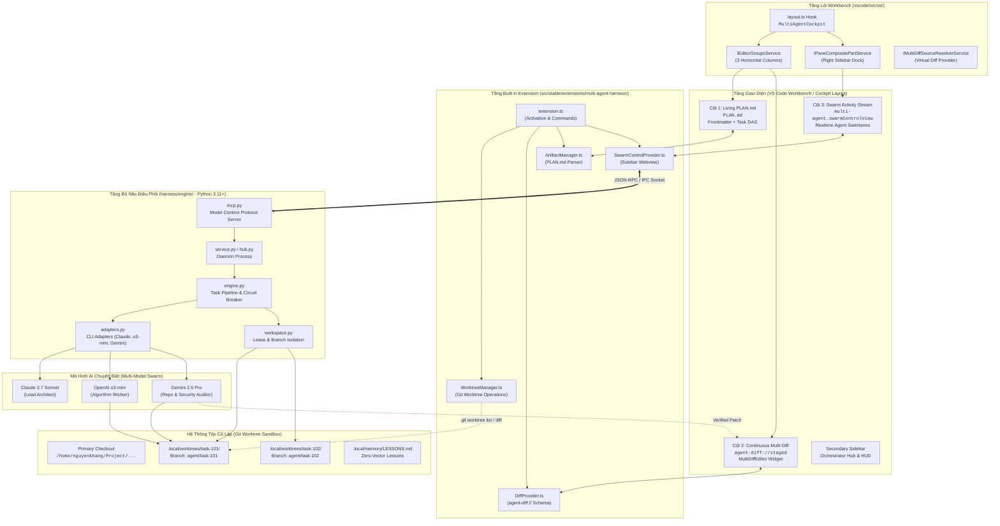
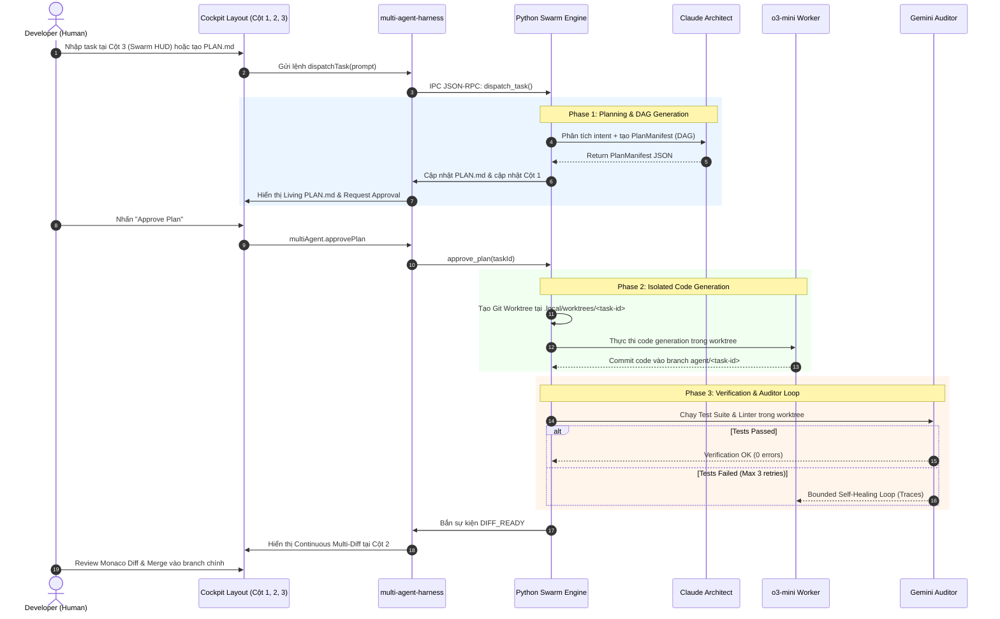

# Multi Agent IDE — Visual Flow & Architecture Map
> **Purpose:** Traceable architecture diagrams and data-flow schemas for live reference during development, maintenance, and upstream upgrades. Keep this file open side-by-side with code editors.

---

## 1. End-to-End System Topology & Data Flow



---

## 2. Chu Trình Thực Thi Tác Vụ Đa Tác Tử (Multi-Agent Execution Lifecycle)



---

## 3. Bản Đồ Tra Cứu Mã Nguồn Nhanh (Code Look-Up Matrix)

Dành cho lập trình viên tra cứu nhanh vị trí code khi sửa chữa hoặc nâng cấp:

| Thành phần | Chức năng chính | Đường dẫn tệp tin | Điểm mở rộng / Sửa chữa |
| :--- | :--- | :--- | :--- |
| **Cockpit Hook** | Tự động chia 3 cột và nạp editors khi mở IDE | [`vscode/src/vs/workbench/browser/layout.ts`](file:///home/nguyenkhang/Project/multi-agent-ide/vscode/src/vs/workbench/browser/layout.ts) | Can thiệp hàm `getInitialEditorsState()` và `restoreParts()` |
| **Cockpit Controller** | Module độc lập chứa toàn bộ cấu hình 3 cột | [`vscode/src/vs/workbench/contrib/multiAgent/browser/multiAgentCockpit.ts`](file:///home/nguyenkhang/Project/multi-agent-ide/vscode/src/vs/workbench/contrib/multiAgent/browser/multiAgentCockpit.ts) | Chỉnh tỷ lệ cột (`groups: [0.28, 0.44, 0.28]`), đường dẫn file mặc định |
| **Diff Staging** | Virtual document provider scheme `agent-diff://` | [`src/stable/extensions/multi-agent-harness/src/diff/DiffProvider.ts`](file:///home/nguyenkhang/Project/multi-agent-ide/src/stable/extensions/multi-agent-harness/src/diff/DiffProvider.ts) | Nâng cấp liên kết sang `MultiDiffEditorInput` (Tầng 2) |
| **Worktree Manager** | Tạo và quản lý `.local/worktrees/<task-id>` | [`src/stable/extensions/multi-agent-harness/src/worktree/WorktreeManager.ts`](file:///home/nguyenkhang/Project/multi-agent-ide/src/stable/extensions/multi-agent-harness/src/worktree/WorktreeManager.ts) | Thêm cherry-pick, rebase, squash và dọn dẹp worktree |
| **Artifact Manager** | Đọc ghi frontmatter metadata trong `PLAN.md` | [`src/stable/extensions/multi-agent-harness/src/artifacts/ArtifactManager.ts`](file:///home/nguyenkhang/Project/multi-agent-ide/src/stable/extensions/multi-agent-harness/src/artifacts/ArtifactManager.ts) | Đồng bộ trạng thái checkbox `[x]` vào database SQLite |
| **Swarm HUD** | Giao diện Webview realtime hiển thị trạng thái tác tử | [`src/stable/extensions/multi-agent-harness/src/views/SwarmControlProvider.ts`](file:///home/nguyenkhang/Project/multi-agent-ide/src/stable/extensions/multi-agent-harness/src/views/SwarmControlProvider.ts) | Tích hợp biểu đồ DAG `@xyflow/react`, streaming token/s |
| **Swarm Engine** | Lõi điều phối tác tử Python | [`harness/engine/engine.py`](file:///home/nguyenkhang/Project/multi-agent-ide/harness/engine/engine.py) | Định tuyến model, mạch ngắt Circuit Breaker khi lỗi 3 lần |
| **Model Adapters** | Giao tiếp CLI Claude, o3-mini, Gemini | [`harness/engine/adapters.py`](file:///home/nguyenkhang/Project/multi-agent-ide/harness/engine/adapters.py) | Thêm adapter Ollama local, OpenRouter, vLLM |
| **Desktop Launcher** | Script khởi chạy standalone không chặn terminal | [`run.sh`](file:///home/nguyenkhang/Project/multi-agent-ide/run.sh) | Tham số Electron, biến môi trường đồ họa Wayland/X11 |

---

## 4. Hướng Dẫn Nâng Cấp Upstream Khi Có Bản Code-OSS Mới (Rebase Protocol)

Khi nâng cấp VS Code (Code-OSS) lên phiên bản mới:
1. **Kiểm tra Patch Hiện có:**
   Toàn bộ can thiệp vào lõi được trích xuất tại thư mục `patches/`. Các patch liên quan đến Multi Agent IDE được đánh số `90+`:
   - `patches/90-multi-agent-tier1-cockpit.patch`
2. **Quy tắc Kiểm tra Trùng lặp (DRY):**
   Mã nguồn của built-in extension nằm tại `src/stable/extensions/multi-agent-harness/`. Thư mục `vscode/extensions/multi-agent-harness` chỉ là một symbolic link. Không bao giờ copy đè file thủ công.
3. **Cập nhật Lại Đồ thị Tri thức:**
   Sau khi sửa code hoặc rebase:
   ```bash
   graphify update .
   ```
   Đồ thị tại `graphify-out/graph.json` sẽ tự động cập nhật ngay lập tức với chi phí 0 token.

